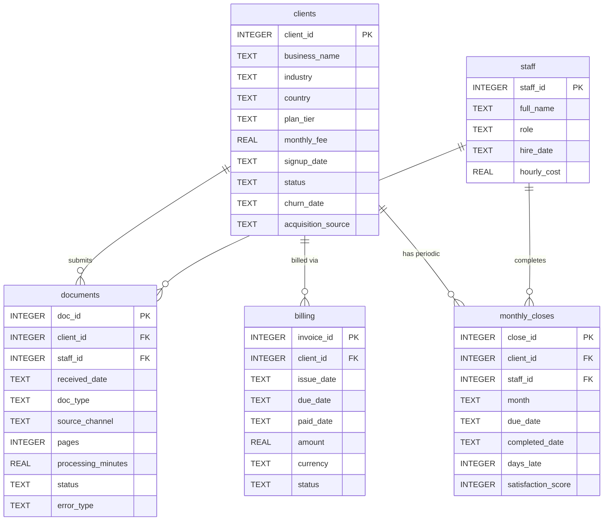

# Harbor & Pine Bookkeeping — Data Dictionary

This document details the relational schema, tables, columns, constraints, and business meanings for the **Harbor & Pine Bookkeeping** synthetic dataset. The dataset represents operational, financial, and client lifecycle data for a boutique bookkeeping firm operating across four English-speaking markets: the United States (US), United Kingdom (UK), Australia (AU), and New Zealand (NZ).

---

## Entity-Relationship Diagram

---

## Table 1: `clients`

Contains profile, tier, geographic, commercial, and lifecycle information for each small business client.

| Column Name | SQL Type | Pandas Type | Nullable? | Key / Constraints | Description / Business Meaning |
| :--- | :--- | :--- | :--- | :--- | :--- |
| `client_id` | `INTEGER` | `int64` | No | `PRIMARY KEY` | Unique numerical identifier for each client business. |
| `business_name` | `TEXT` | `object` | No | None | Synthetic trading name of the client entity. |
| `industry` | `TEXT` | `object` | No | Categorical | Operating industry sector: `Restaurant`, `Retail`, `Construction`, `Consulting`, `Healthcare`, `E-commerce`, `Real Estate`, `Trades`. |
| `country` | `TEXT` | `object` | No | Categorical (`US`, `UK`, `AU`, `NZ`) | Primary operational jurisdiction of the business. Dictates billing currency and tax calendar seasonality. |
| `plan_tier` | `TEXT` | `object` | No | Categorical (`Basic`, `Standard`, `Premium`) | Service tier contracted by the client. Dictates service level, document volume expectations, and pricing. |
| `monthly_fee` | `REAL` | `float64` | No | Positive float | Contracted recurring monthly subscription fee in the client's local currency. |
| `signup_date` | `TEXT` | `object` (`YYYY-MM-DD`) | No | ISO 8601 Date | Date the client formally onboarded and began bookkeeping services. |
| `status` | `TEXT` | `object` | No | Categorical (`Active`, `Churned`) | Current relationship status of the client. |
| `churn_date` | `TEXT` | `object` (`YYYY-MM-DD`) | **Yes** | ISO 8601 Date (`NULL` for `Active`) | Date the client terminated their service agreement. Must be strictly `NULL` for `Active` clients and `>= signup_date` for `Churned` clients. |
| `acquisition_source` | `TEXT` | `object` | No | Categorical | Channel through which the client was acquired: `Referral`, `Google`, `LinkedIn`, `Accountant Partner`, `Facebook`. |

---

## Table 2: `staff`

Profiles internal bookkeeping personnel who process source documents and perform monthly balance reconciliations.

| Column Name | SQL Type | Pandas Type | Nullable? | Key / Constraints | Description / Business Meaning |
| :--- | :--- | :--- | :--- | :--- | :--- |
| `staff_id` | `INTEGER` | `int64` | No | `PRIMARY KEY` | Unique numerical identifier for each employee. |
| `full_name` | `TEXT` | `object` | No | None | Synthetic full name of the employee. |
| `role` | `TEXT` | `object` | No | Categorical (`Bookkeeper`, `Senior Bookkeeper`, `Manager`) | Staff organizational rank and operational responsibility tier. |
| `hire_date` | `TEXT` | `object` (`YYYY-MM-DD`) | No | ISO 8601 Date | Date the staff member joined Harbor & Pine. Precedes all task assignments. |
| `hourly_cost` | `REAL` | `float64` | No | Positive float | Internal direct hourly cost of employment (wages, taxes, benefits) in USD. |

---

## Table 3: `documents`

Operational log of financial records and transactional source artifacts delivered by clients for processing and ledger recording.

| Column Name | SQL Type | Pandas Type | Nullable? | Key / Constraints | Description / Business Meaning |
| :--- | :--- | :--- | :--- | :--- | :--- |
| `doc_id` | `INTEGER` | `int64` | No | `PRIMARY KEY` | Unique numerical identifier for the document item. |
| `client_id` | `INTEGER` | `int64` | No | `FOREIGN KEY` -> `clients(client_id)` | The client entity that submitted the document. |
| `staff_id` | `INTEGER` | `int64` | No | `FOREIGN KEY` -> `staff(staff_id)` | The staff member assigned to intake, transcribe, and reconcile the document. |
| `received_date` | `TEXT` | `object` (`YYYY-MM-DD`) | No | ISO 8601 Date | Date the document was submitted by the client. Must fall between `signup_date` and `churn_date` (or dataset cutoff). |
| `doc_type` | `TEXT` | `object` | No | Categorical | Classification of source document: `Receipt`, `Supplier Invoice`, `Bank Statement`, `Payroll Report`. |
| `source_channel` | `TEXT` | `object` | No | Categorical | Submission intake method: `Email`, `Upload` (web portal), `Photo` (mobile phone capture), `Paper Scan`. |
| `pages` | `INTEGER` | `int64` | No | Integer `>= 1` | Page count of the submitted document artifact. |
| `processing_minutes`| `REAL` | `float64` | No | Positive float | Direct minutes elapsed by staff to verify, transcribe, code, and file the document into the ledger. |
| `status` | `TEXT` | `object` | No | Categorical (`Processed`, `Rework`, `Failed`) | Intake processing state: `Processed` (clean entry), `Rework` (required staff correction or clarification), `Failed` (rejected/unusable). |
| `error_type` | `TEXT` | `object` | **Yes** | Categorical (`NULL` if `Processed`) | Root cause category if the document encountered an issue: `Unreadable`, `Wrong Amount`, `Missing Info`, `Duplicate`. Strictly `NULL` for `Processed` documents. |

---

## Table 4: `billing`

Commercial ledger of subscription and service invoices issued to clients, tracking receivables, payment latencies, and cash flow.

| Column Name | SQL Type | Pandas Type | Nullable? | Key / Constraints | Description / Business Meaning |
| :--- | :--- | :--- | :--- | :--- | :--- |
| `invoice_id` | `INTEGER` | `int64` | No | `PRIMARY KEY` | Unique numerical identifier for each client billing invoice. |
| `client_id` | `INTEGER` | `int64` | No | `FOREIGN KEY` -> `clients(client_id)` | The client being billed. |
| `issue_date` | `TEXT` | `object` (`YYYY-MM-DD`) | No | ISO 8601 Date | Date the invoice was generated and transmitted to the client. |
| `due_date` | `TEXT` | `object` (`YYYY-MM-DD`) | No | ISO 8601 Date | Contractual due date for payment (`issue_date` + terms, e.g. 14 or 30 days). |
| `paid_date` | `TEXT` | `object` (`YYYY-MM-DD`) | **Yes** | ISO 8601 Date (`NULL` if unpaid) | Date payment was settled and cleared. Strictly `NULL` for `Open` and `Overdue` invoices. When present, `paid_date >= issue_date`. |
| `amount` | `REAL` | `float64` | No | Positive float | Invoice total billed to the client, denominated in `currency`. |
| `currency` | `TEXT` | `object` | No | Categorical (`USD`, `GBP`, `AUD`, `NZD`) | Three-letter ISO currency code strictly matching the client's operating country (`US -> USD`, `UK -> GBP`, `AU -> AUD`, `NZ -> NZD`). |
| `status` | `TEXT` | `object` | No | Categorical (`Paid`, `Overdue`, `Open`) | Current settlement state: `Paid` (funds received), `Overdue` (unpaid and `due_date < 2024-12-31`), `Open` (unpaid and `due_date >= 2024-12-31`). |

---

## Table 5: `monthly_closes`

Records monthly financial period close execution, milestone tracking, deadline adherence, and post-close client satisfaction feedback.

| Column Name | SQL Type | Pandas Type | Nullable? | Key / Constraints | Description / Business Meaning |
| :--- | :--- | :--- | :--- | :--- | :--- |
| `close_id` | `INTEGER` | `int64` | No | `PRIMARY KEY` | Unique numerical identifier for each monthly accounting close engagement. |
| `client_id` | `INTEGER` | `int64` | No | `FOREIGN KEY` -> `clients(client_id)` | The client entity whose financial books are being reconciled. |
| `staff_id` | `INTEGER` | `int64` | No | `FOREIGN KEY` -> `staff(staff_id)` | Staff member responsible for the reconciliation and monthly close sign-off. |
| `month` | `TEXT` | `object` (`YYYY-MM`) | No | ISO 8601 Month | The accounting calendar month being reconciled and closed (e.g. `2023-04`). |
| `due_date` | `TEXT` | `object` (`YYYY-MM-DD`) | No | ISO 8601 Date | Target completion date for closing the period (typically the 15th of the subsequent month). |
| `completed_date` | `TEXT` | `object` (`YYYY-MM-DD`) | No | ISO 8601 Date | Actual date the reconciliation was completed and the books were locked. |
| `days_late` | `INTEGER` | `int64` | No | Integer `>= 0` | Days elapsed past `due_date`: `MAX(0, JULIANDAY(completed_date) - JULIANDAY(due_date))`. 0 if completed on or before the deadline. |
| `satisfaction_score`| `INTEGER` | `float64` / `Int64` | **Yes** | Integer `1` to `5` (`NULL` for ~20%) | Client feedback rating (1 = Poor, 5 = Excellent). Approximately 20% of entries are `NULL` due to non-response. |

---

## Relational & Domain Integrity Rules

1. **Foreign Key Integrity**:
   - `documents.client_id` and `documents.staff_id` reference valid keys in `clients` and `staff`.
   - `billing.client_id` references valid keys in `clients`.
   - `monthly_closes.client_id` and `monthly_closes.staff_id` reference valid keys in `clients` and `staff`.
2. **Temporal Consistency**:
   - For all child tables (`documents`, `billing`, `monthly_closes`), event dates fall within the client's active lifespan (`signup_date` through `churn_date` or the snapshot date `2024-12-31`).
   - Staff assignment dates comply with `staff.hire_date <= event_date`.
   - For `billing`, `paid_date >= issue_date`.
   - For `monthly_closes`, `days_late = MAX(0, CAST(JULIANDAY(completed_date) - JULIANDAY(due_date) AS INTEGER))`.
3. **Currency Alignment**:
   - Every invoice currency strictly reflects the client's country of domicile (`US -> USD`, `UK -> GBP`, `AU -> AUD`, `NZ -> NZD`).
4. **Permitted `NULL` Fields**:
   - `clients.churn_date`: `NULL` if and only if `status = 'Active'`.
   - `documents.error_type`: `NULL` if and only if `status = 'Processed'`.
   - `billing.paid_date`: `NULL` if and only if `status IN ('Open', 'Overdue')`.
   - `monthly_closes.satisfaction_score`: `NULL` for non-responding survey submissions (~20% rate).
   - All other fields across all tables are non-nullable (`NOT NULL`).
